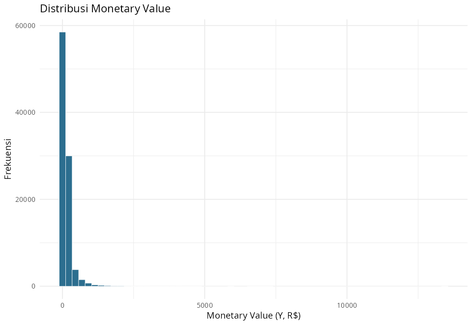
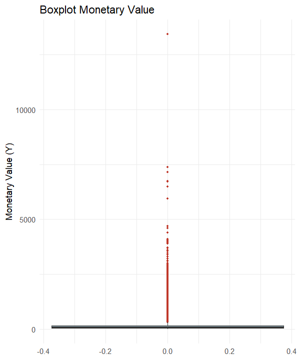
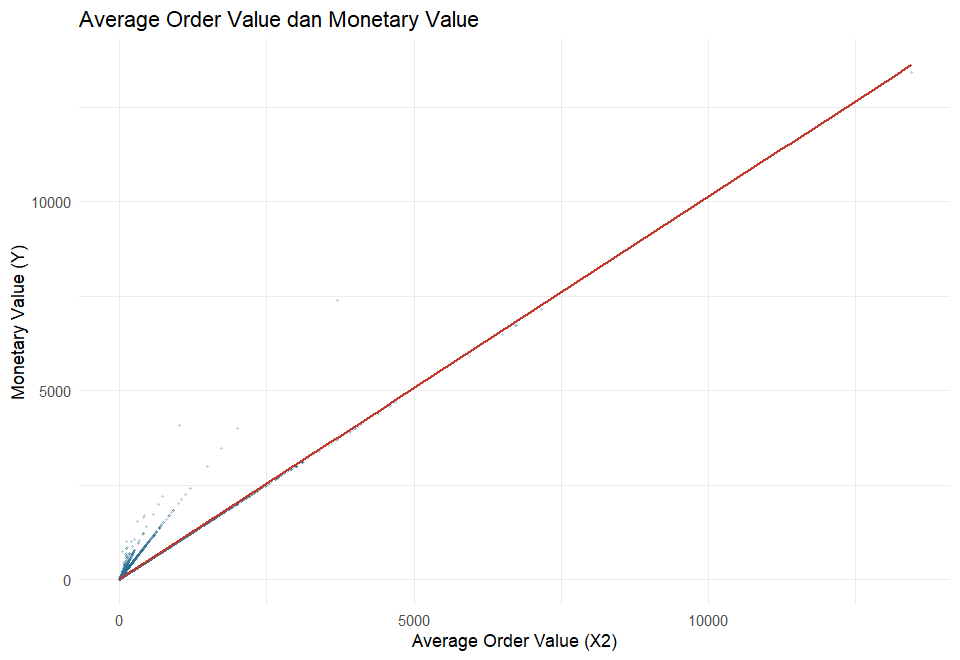
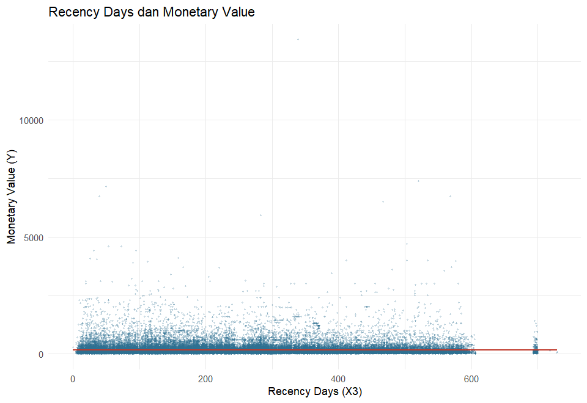
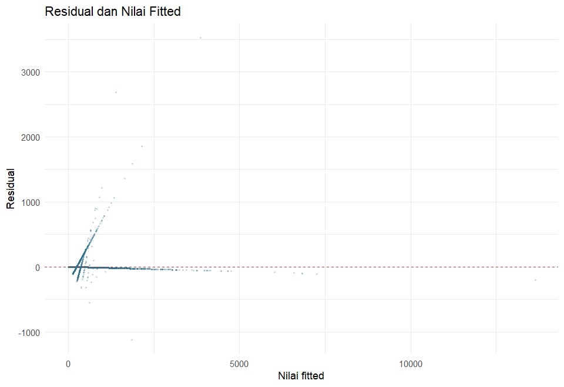
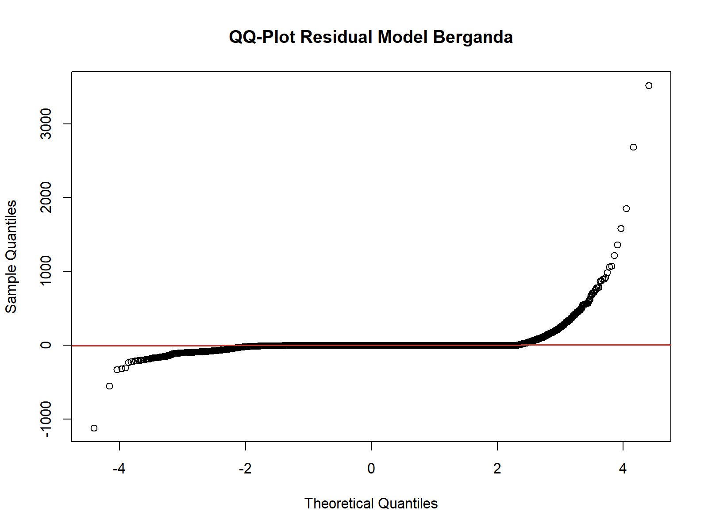

# Hasil: Analisis Nilai Transaksi Pelanggan E-Commerce Brasil

Halaman ini merangkum hasil pipeline `R/analysis.R`. Sumber datanya adalah
`mehmetisik/order-customerrfm` dari Kaggle dengan judul *Brazil E-commerce Orders
Dataset*. Berkas mentah memuat 112.650 baris transaksi level order-item, 98.666
order unik, dan 95.420 pelanggan. Pipeline mengagregasi transaksi menjadi satu
baris per pelanggan. Penyaringan `NA` tidak membuang baris, begitu pula
pemeriksaan duplikat. Baris final berjumlah 95.420. Seluruh nilai memakai satuan
dataset tanpa simbol mata uang.

Variabel yang dianalisis:

- `Y` = `Monetary_Value`, total `price` per pelanggan
- `X1` = `Total_Purchases`, jumlah `order_id` unik per pelanggan
- `X2` = `Average_Order_Value`, total nilai dibagi jumlah order
- `X3` = `Recency_Days`, selisih hari dari transaksi terakhir ke 2018-09-03

## 1. Ringkasan pipeline

| Tahap | Hasil |
|---|---|
| Sumber data | Kaggle `mehmetisik/order-customerrfm`, 112.650 baris transaksi, 4 kolom |
| Agregasi | Satu baris per pelanggan, menghasilkan 95.420 observasi |
| Pra-pengolahan | Pemeriksaan kolom wajib, agregasi, `complete.cases()`, lalu pembuangan duplikat dengan `!duplicated()` |
| Baris akhir | 95.420 baris, 0 dibuang karena `NA`, 0 duplikat dibuang, total 0 baris dibuang |
| Statistik deskriptif | Rataan, median, modus, varians, simpangan baku, minimum, kuartil, maksimum |
| Korelasi | Matriks Pearson untuk empat variabel model |
| Regresi | Model sederhana `Y ~ X1` dan model berganda `Y ~ X1 + X2 + X3` |
| Uji asumsi | VIF, Shapiro-Wilk pada 5.000 residual acak, Breusch-Pagan |
| Prediksi | Tiga skenario kuartil dengan interval kepercayaan 95 persen |
| Visualisasi | Tujuh plot tersimpan di `assets/` dan `output/plots/` |

## 2. EDA: tujuh visualisasi

### G1: Distribusi `Monetary_Value`

Rataan `Monetary_Value` sebesar 142,44 dan median 89,90. Simpangan baku 217,66
jauh lebih besar daripada rataan, dengan nilai maksimum 13.440. Histogram
menunjukkan ekor kanan yang panjang, sehingga rataan lebih tinggi daripada
median.

### G2: Boxplot `Monetary_Value`

Boxplot menegaskan konsentrasi nilai pada kisaran kuartil pertama sampai kuartil
ketiga, yaitu 47,90 sampai 155,00. Titik-titik di atas whisker membentuk ekor
kanan. Median 89,90 berada di bawah rataan karena sejumlah pelanggan memiliki
total transaksi jauh di atas kebanyakan pelanggan lain.

### G3: `Total_Purchases` terhadap `Monetary_Value`

Korelasi Pearson `Y` dengan `X1` sebesar 0,106. Garis regresi pada scatter naik,
tetapi penyebaran titik lebar. Sebagian besar pelanggan hanya memiliki satu
order, sehingga prediktor ini memiliki variasi kecil.

### G4: `Average_Order_Value` terhadap `Monetary_Value`

Korelasi `Y` dengan `X2` sebesar 0,985, jauh lebih tinggi daripada prediktor
lain. Hubungan ini mengandung identitas aljabar karena X2 dibentuk dari Y dibagi
X1. Interpretasi sebagai hubungan empiris perlu dibatasi pada cara kedua
variabel itu dihitung.

### G5: `Recency_Days` terhadap `Monetary_Value`

Korelasi `Y` dengan `X3` hanya 0,001. Secara deskriptif, selisih hari sejak
transaksi terakhir tidak menunjukkan hubungan linier dengan `Monetary_Value`.
Pada model berganda, koefisien X3 bernilai -0,001 dan tidak signifikan dengan
p-value 0,264.

### G6: Residual terhadap nilai fitted

Plot residual menunjukkan sebaran yang berubah pada nilai fitted tinggi. Uji
Breusch-Pagan mengonfirmasi heteroskedastisitas dengan `BP = 1992,3`, `df = 3`,
dan `p-value < 2,2e-16`.

### G7: QQ plot residual

Titik-titik menyimpang dari garis diagonal, terutama pada ekor. Uji
Shapiro-Wilk atas 5.000 residual acak menghasilkan `W = 0,21583` dan
`p-value < 2,2e-16`, sehingga normalitas residual ditolak.

## 3. Statistik deskriptif

| Variabel | Rataan | Median | Modus | Varians | SD | Minimum | Q1 | Q3 | Maksimum |
|---|---:|---:|---:|---:|---:|---:|---:|---:|---:|
| `Monetary_Value` | 142,44 | 89,90 | 59,90 | 47.374,29 | 217,66 | 0,85 | 47,90 | 155,00 | 13.440,00 |
| `Total_Purchases` | 1,03 | 1 | 1,00 | 0,045 | 0,21 | 1 | 1 | 1 | 16 |
| `Average_Order_Value` | 138,23 | 87,38 | 59,90 | 44.695,92 | 211,41 | 0,85 | 46,40 | 149,90 | 13.440,00 |
| `Recency_Days` | 243,50 | 224 | 283,00 | 23.458,25 | 153,16 | 0 | 119 | 353 | 729 |

`Total_Purchases` memiliki rataan 1,03 dan kuartil ketiga 1. Nilai ini
menggambarkan bahwa mayoritas pelanggan hanya bertransaksi dalam satu order.
Nilai maksimum 16 muncul pada sejumlah kecil pelanggan.

## 4. Korelasi Pearson

| Pasangan | Korelasi |
|---|---:|
| `Monetary_Value` dengan `Total_Purchases` | 0,106 |
| `Monetary_Value` dengan `Average_Order_Value` | 0,985 |
| `Monetary_Value` dengan `Recency_Days` | 0,001 |
| `Total_Purchases` dengan `Average_Order_Value` | -0,011 |
| `Total_Purchases` dengan `Recency_Days` | -0,022 |
| `Average_Order_Value` dengan `Recency_Days` | 0,004 |

Korelasi antar prediktor berada di sekitar nol, sejalan dengan nilai VIF yang
berada di sekitar 1. Korelasi sangat tinggi antara Y dan X2 tidak menjadi bukti
multikolinearitas, melainkan akibat definisi X2 yang memakai Y.

### Korelasi Spearman (pembanding Pearson)

Spearman tahan terhadap outlier dan hanya memakai urutan, sehingga menjadi
pembanding yang berguna karena `Monetary_Value` sangat timpang ke kanan.

| Pasangan | Spearman |
|---|---:|
| `Monetary_Value` dengan `Total_Purchases` | 0,146 |
| `Monetary_Value` dengan `Average_Order_Value` | 0,989 |
| `Monetary_Value` dengan `Recency_Days` | -0,010 |
| `Total_Purchases` dengan `Average_Order_Value` | 0,011 |
| `Total_Purchases` dengan `Recency_Days` | -0,019 |
| `Average_Order_Value` dengan `Recency_Days` | -0,008 |

Kesimpulannya sama dengan Pearson: Y–X2 paling kuat, Y–X1 lemah, Y–X3 hampir
nol. Spearman Y–X3 yang kecil dan negatif (-0,010, p = 0,002) menunjukkan
hubungan monoton yang sangat lemah, bukan hubungan linear yang berarti.

## 5. Regresi linear

| Model | Intercept | X1 | X2 | X3 | R² | R² tersesuaian |
|---|---:|---:|---:|---:|---:|---:|
| `Y ~ X1` | 29,523 | 109,202 | | | 0,0112 | 0,0112 |
| `Y ~ X1 + X2 + X3` | -122,076 | 120,285 | 1,015 | -0,001 | 0,9831 | 0,9831 |

Model sederhana menjelaskan 1,12 persen variasi `Monetary_Value`. Penambahan
`X2` dan `X3` menaikkan R² menjadi 98,31 persen. Kenaikan ini terutama mengikuti
identitas aljabar `X2 = Y / X1`, bukan kemampuan prediksi di luar cara X2
dibentuk. Koefisien X3 bernilai -0,001 dengan `p-value = 0,264`, sehingga tidak
signifikan pada taraf 5 persen. Statistik F model berganda sebesar 1.853.402
dengan `p-value < 2,2e-16`.

### Model pembanding tanpa X2

Untuk membuktikan bahwa kenaikan R² di atas berasal dari definisi X2, bukan
dari X1 atau X3, ditaksir model `Y ~ X1 + X3`:

| Model | Intercept | X1 | X3 | R² | R² tersesuaian |
|---|---:|---:|---:|---:|---:|
| `Y ~ X1 + X3` | 28,322 | 109,277 | 0,005 | 0,0112 | 0,0112 |

R²-nya 0,0112 — praktis sama dengan model sederhana `Y ~ X1` (0,0112) dan
jauh dari 0,9831. X3 juga tetap tidak signifikan (p-value 0,313). Jadi
seluruh lompatan R² model berganda berasal dari X2, yang didefinisikan
sebagai `Y / X1`.

## 6. Uji asumsi

| Uji | Statistik | Kesimpulan |
|---|---|---|
| VIF `Total_Purchases` | 1,000619 | Tidak ada multikolinearitas berarti |
| VIF `Average_Order_Value` | 1,000133 | Tidak ada multikolinearitas berarti |
| VIF `Recency_Days` | 1,000515 | Tidak ada multikolinearitas berarti |
| Shapiro-Wilk | `W = 0,21583`, `p < 2,2e-16` | Normalitas residual ditolak |
| Breusch-Pagan | `BP = 1992,3`, `df = 3`, `p < 2,2e-16` | Homoskedastisitas ditolak |

Pelanggaran dua asumsi tersebut dicatat sebagai keterbatasan. Standar error
konvensional dapat meleset, sehingga uji t, statistik F, dan interval
kepercayaan perlu dibaca dengan hati-hati.

Galat baku robust HC1 (`output/tables/uji_asumsi_robust.csv`) tidak mengubah
kesimpulan: X1 dan X2 tetap signifikan, X3 tetap tidak signifikan
(p-robust 0,327).

Sebagai pemeriksaan sensitivitas, model `log(Y) ~ X1 + X3` menghasilkan
R² 0,0201 dan pelanggaran asumsi yang jauh lebih ringan (Breusch-Pagan
LM 19,6 dibanding 1992,3 pada model linear; residual lebih dekat ke normal),
tetapi asumsi tetap ditolak secara statistik dan X3 tetap tidak signifikan
(p-value 0,110). Transformasi log memperbaiki, bukan menyelesaikan,
pelanggaran asumsi.

## 7. Prediksi tiga skenario

| Skenario | `Total_Purchases` | `Average_Order_Value` | `Recency_Days` | Prediksi | Batas bawah 95% | Batas atas 95% |
|---|---:|---:|---:|---:|---:|---:|
| Rendah | 1 | 46,40 | 119 | 45,23 | 44,98 | 45,47 |
| Menengah | 1 | 87,38 | 224 | 86,75 | 86,57 | 86,94 |
| Tinggi | 1 | 149,90 | 353 | 150,12 | 149,90 | 150,35 |

Nilai prediksi pada tiga kuartil prediktor ini bersifat deskriptif. Interval yang
ditampilkan adalah interval kepercayaan 95 persen untuk rataan, bukan interval
prediksi untuk satu pelanggan.

## 8. Keterbatasan

- Dataset mencatat transaksi e-commerce Brasil dan tidak mewakili pasar
  Indonesia.
- `Average_Order_Value` diturunkan dari `Monetary_Value`, sehingga R² tinggi
  tidak dapat dipakai sebagai bukti kekuatan prediktif umum.
- Baris transaksi identik tetap dihitung karena berkas mentah tidak memuat
  identitas produk. Baris tersebut dapat berupa produk berbeda dengan harga
  sama pada satu order.
- Normalitas dan homoskedastisitas residual ditolak, sehingga inference
  konvensional perlu dibaca dengan hati-hati.
- Hubungan yang ditemukan bersifat asosiasi, bukan sebab akibat.
- Prediksi memakai tiga kombinasi kuartil dan tidak mencakup seluruh rentang
  nilai prediktor.

Rincian numerik tersedia di `output/tables/`, sedangkan log lengkap ada di
`output/analisis_log.txt`. Penjelasan metodologi dan cara menjalankan ulang
pipeline ada di [README.md](README.md).
