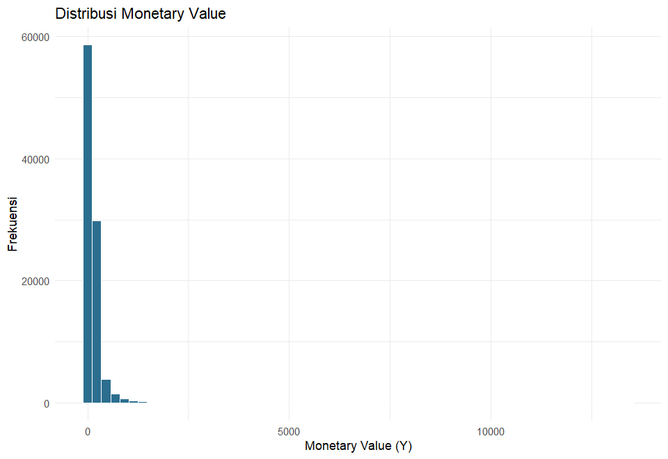
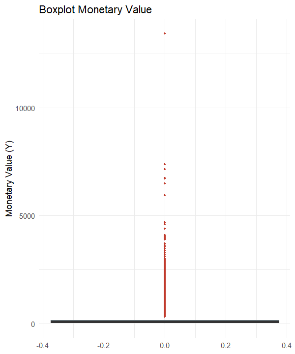
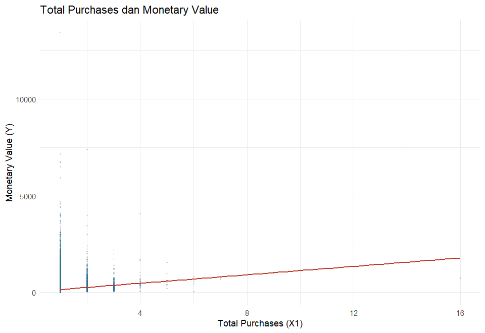
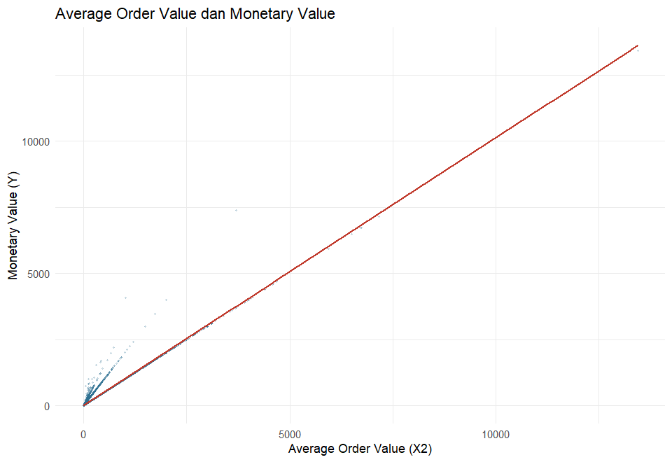
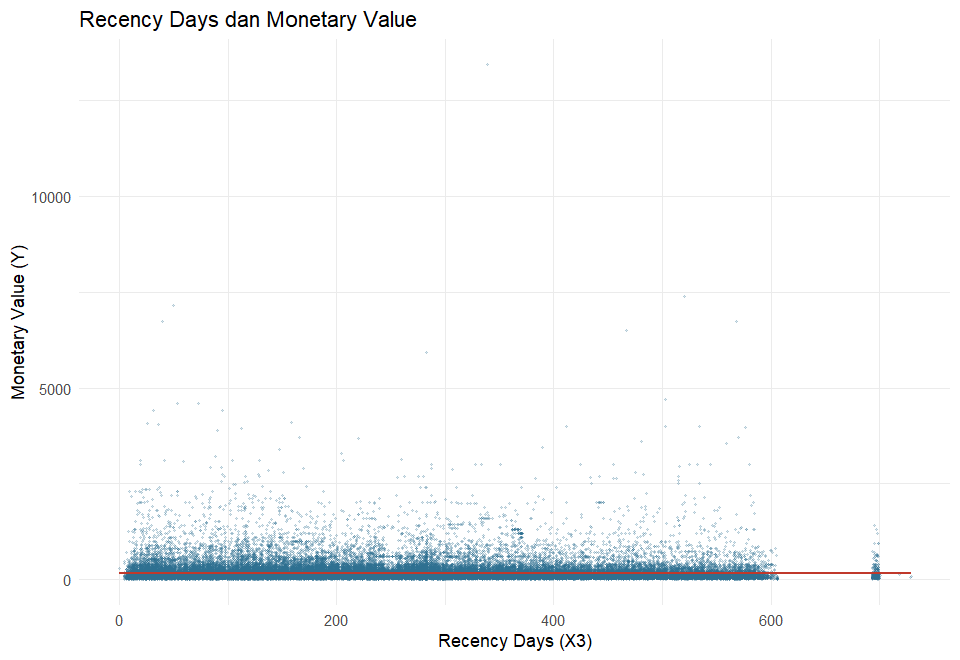
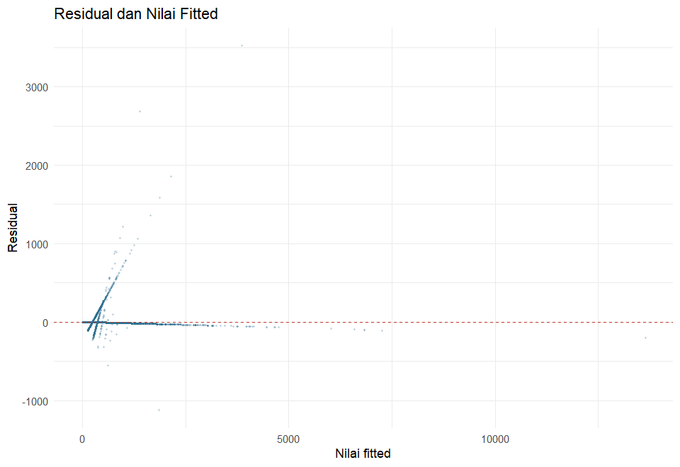
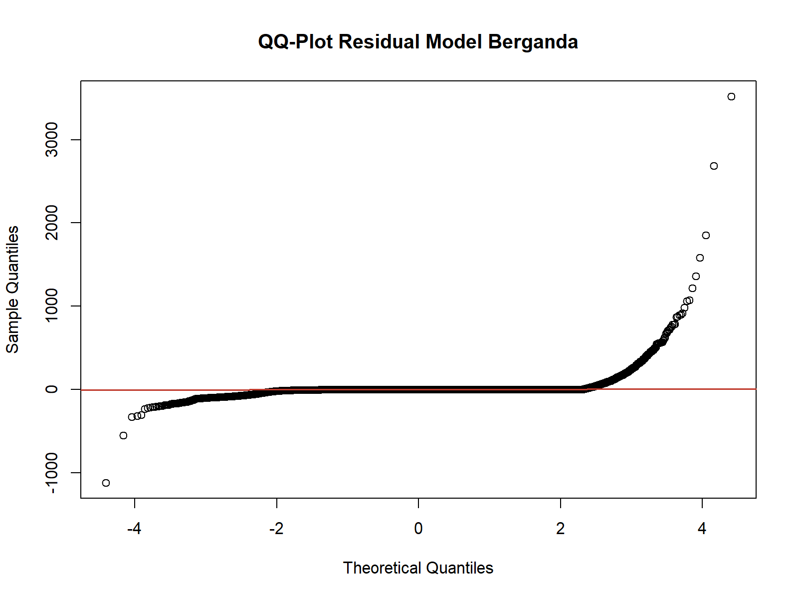

```{r setup, include=FALSE}
knitr::opts_chunk$set(echo = FALSE, warning = FALSE, message = FALSE, fig.align = "center")
suppressPackageStartupMessages(library(car))

df <- read.csv("../data/processed/order_customer_clean.csv", stringsAsFactors = FALSE)
desc <- read.csv("../output/tables/statistik_deskriptif.csv", stringsAsFactors = FALSE)
korelasi <- read.csv("../output/tables/korelasi.csv", check.names = FALSE, row.names = 1)
prediksi <- read.csv("../output/tables/prediksi.csv", stringsAsFactors = FALSE)
uji_raw <- readLines("../output/tables/uji_asumsi.txt", warn = FALSE)
prov_raw <- readLines("../output/tables/provenance.txt", warn = FALSE)
log_raw <- readLines("../output/analisis_log.txt", warn = FALSE)

ambil_baris <- function(pattern, teks) grep(pattern, teks, value = TRUE)[1]
url_sumber <- sub("^URL Kaggle: +", "", ambil_baris("^URL Kaggle", prov_raw))
lisensi <- sub("^Lisensi: +", "", ambil_baris("^Lisensi", prov_raw))
tanggal_verifikasi <- sub("^Tanggal pembaruan: +", "", ambil_baris("^Tanggal pembaruan", prov_raw))
baris_transaksi <- as.numeric(sub(
  "^Baris transaksi order-item: +", "",
  ambil_baris("^Baris transaksi order-item:", log_raw)
))
order_unik <- as.numeric(sub("^Order unik: +", "", ambil_baris("^Order unik:", log_raw)))
tanggal_referensi <- sub("^Tanggal referensi recency: +", "", ambil_baris("^Tanggal referensi recency:", log_raw))
baris_awal <- as.numeric(sub("^Baris awal: +", "", ambil_baris("^Baris awal:", log_raw)))
baris_na <- as.numeric(sub("^Baris dibuang karena NA: +", "", ambil_baris("^Baris dibuang karena NA:", log_raw)))
baris_duplikat <- as.numeric(sub("^Baris duplikat dibuang: +", "", ambil_baris("^Baris duplikat dibuang:", log_raw)))
baris_final <- nrow(df)
baris_dibuang <- baris_awal - baris_final

fmt <- function(x, digits = 0) {
  formatC(x, format = "f", digits = digits, big.mark = ".", decimal.mark = ",")
}

fmt_p <- function(p) {
  if (p < 2.2e-16) return("< 2,2e-16")
  sub("\\.", ",", formatC(p, format = "e", digits = 2))
}

stat <- function(v) desc[desc$variabel == v, ]
y <- stat("Monetary_Value")
x1 <- stat("Total_Purchases")
x2 <- stat("Average_Order_Value")
x3 <- stat("Recency_Days")

model_sederhana <- lm(Monetary_Value ~ Total_Purchases, data = df)
model_berganda <- lm(
  Monetary_Value ~ Total_Purchases + Average_Order_Value + Recency_Days,
  data = df
)
ring_sederhana <- summary(model_sederhana)
ring_berganda <- summary(model_berganda)

r2_sederhana <- ring_sederhana$r.squared
r2_berganda <- ring_berganda$r.squared
adj_r2_berganda <- ring_berganda$adj.r.squared
f_berganda <- ring_berganda$fstatistic[1]
b0_sederhana <- coef(model_sederhana)["(Intercept)"]
b1_sederhana <- coef(model_sederhana)["Total_Purchases"]
b0 <- coef(model_berganda)["(Intercept)"]
b1 <- coef(model_berganda)["Total_Purchases"]
b2 <- coef(model_berganda)["Average_Order_Value"]
b3 <- coef(model_berganda)["Recency_Days"]
p1 <- ring_berganda$coefficients["Total_Purchases", 4]
p2 <- ring_berganda$coefficients["Average_Order_Value", 4]
p3 <- ring_berganda$coefficients["Recency_Days", 4]
vif <- car::vif(model_berganda)

baris_w <- ambil_baris("^W = ", uji_raw)
w_shapiro <- as.numeric(sub("^W = ([0-9.]+).*", "\\1", baris_w))
baris_bp <- ambil_baris("^BP = ", uji_raw)
bp <- as.numeric(sub("^BP = ([0-9.]+).*", "\\1", baris_bp))
df_bp <- as.numeric(sub(".*df = ([0-9]+).*", "\\1", baris_bp))

label_var <- c(
  Monetary_Value = "Y: Monetary Value",
  Total_Purchases = "X1: Total Purchases",
  Average_Order_Value = "X2: Average Order Value",
  Recency_Days = "X3: Recency Days"
)

desc_tampil <- data.frame(
  Variabel = unname(label_var[desc$variabel]),
  Rataan = fmt(desc$mean, 2),
  Median = fmt(desc$median, 2),
  Modus = fmt(desc$modus, 2),
  Varians = fmt(desc$varians, 2),
  SD = fmt(desc$sd, 2),
  Minimum = fmt(desc$min, 2),
  Q1 = fmt(desc$q1, 2),
  Q3 = fmt(desc$q3, 2),
  Maksimum = fmt(desc$max, 2),
  check.names = FALSE
)

korelasi_tampil <- data.frame(
  Variabel = unname(label_var[rownames(korelasi)]),
  Y = fmt(korelasi[, "Monetary_Value"], 3),
  X1 = fmt(korelasi[, "Total_Purchases"], 3),
  X2 = fmt(korelasi[, "Average_Order_Value"], 3),
  X3 = fmt(korelasi[, "Recency_Days"], 3),
  check.names = FALSE
)

koef_tampil <- data.frame(
  Model = c("Sederhana", "Sederhana", "Berganda", "Berganda", "Berganda", "Berganda"),
  Prediktor = c(
    "Intercept", "X1: Total Purchases",
    "Intercept", "X1: Total Purchases", "X2: Average Order Value", "X3: Recency Days"
  ),
  Estimasi = fmt(c(b0_sederhana, b1_sederhana, b0, b1, b2, b3), 3),
  `Galat baku` = fmt(c(
    ring_sederhana$coefficients["(Intercept)", 2],
    ring_sederhana$coefficients["Total_Purchases", 2],
    ring_berganda$coefficients["(Intercept)", 2],
    ring_berganda$coefficients["Total_Purchases", 2],
    ring_berganda$coefficients["Average_Order_Value", 2],
    ring_berganda$coefficients["Recency_Days", 2]
  ), 3),
  p = c(
    fmt_p(ring_sederhana$coefficients["(Intercept)", 4]),
    fmt_p(ring_sederhana$coefficients["Total_Purchases", 4]),
    fmt_p(ring_berganda$coefficients["(Intercept)", 4]),
    fmt_p(p1), fmt_p(p2), fmt_p(p3)
  ),
  check.names = FALSE
)

vif_tampil <- data.frame(
  Prediktor = names(vif),
  VIF = fmt(as.numeric(vif), 4),
  check.names = FALSE
)

prediksi_tampil <- data.frame(
  Skenario = prediksi$skenario,
  X1 = fmt(prediksi$total_purchases, 0),
  X2 = fmt(prediksi$average_order_value, 2),
  X3 = fmt(prediksi$recency_days, 0),
  Prediksi = fmt(prediksi$prediksi, 2),
  `Batas bawah 95%` = fmt(prediksi$batas_bawah_95, 2),
  `Batas atas 95%` = fmt(prediksi$batas_atas_95, 2),
  check.names = FALSE
)
```

# Bab 1 Pendahuluan

Laporan ini menganalisis hubungan antara nilai transaksi pelanggan dan tiga
ukuran perilaku belanja pada *Brazil E-commerce Orders Dataset*. Dataset ini
berasal dari Kaggle dan berisi transaksi e-commerce Brasil. Unit analisis bukan
individualitas transaksi, melainkan pelanggan. Nilai transaksi per pelanggan
menjadi variabel respons `Monetary_Value`. Prediktornya adalah
`Total_Purchases` sebagai X1, `Average_Order_Value` sebagai X2, dan
`Recency_Days` sebagai X3.

Pertanyaan analisis mencakup tiga hal. Pertama, seberapa besar hubungan setiap
prediktor dengan `Monetary_Value`. Kedua, seberapa besar model regresi sederhana
dan berganda menjelaskan variasi `Monetary_Value`. Ketiga, apakah asumsi klasik
regresi terpenuhi pada data ini.

# Bab 2 Sumber Data dan Pra-Pengolahan

Data diperoleh dari `r url_sumber`. Metadata Kaggle mencantumkan lisensi
`r lisensi` dan pembaruan terakhir `r tanggal_verifikasi`. Berkas mentah
memuat `r fmt(baris_transaksi)` baris transaksi level order-item,
`r fmt(order_unik)` order unik, dan empat kolom, yaitu `order_id`,
`customer_unique_id`, `order_purchase_timestamp`, dan `price`.

Pipeline mengubah data transaksi menjadi satu baris per pelanggan.
`Total_Purchases` dihitung dari jumlah `order_id` unik.
`Monetary_Value` merupakan penjumlahan `price` per pelanggan.
`Average_Order_Value` adalah `Monetary_Value` dibagi `Total_Purchases`.
`Recency_Days` adalah selisih hari antara tanggal transaksi terakhir tiap
pelanggan dengan tanggal referensi `r tanggal_referensi`.

Agregasi menghasilkan `r fmt(baris_awal)` pelanggan. Penyaringan `NA` pada empat
variabel model membuang `r fmt(baris_na)` baris dan menyisakan
`r fmt(baris_awal - baris_na)` baris. Pemeriksaan duplikat setelah itu membuang
`r fmt(baris_duplikat)` baris, sehingga baris final berjumlah
`r fmt(baris_final)` baris dengan total `r fmt(baris_dibuang)` baris dikeluarkan.
Tidak ada filter outlier atau kategori lain yang diterapkan.

Baris transaksi yang identik tetap dipertahankan saat agregasi karena berkas
mentah tidak memuat identitas produk. Baris tersebut dapat berupa produk
berbeda dengan harga sama pada satu order. Pemeriksaan duplikat dilakukan pada
tabel hasil agregasi, bukan pada baris transaksi mentah.

# Bab 3 Statistika Deskriptif

Tabel 3.1 merangkum statistik deskriptif dari
`output/tables/statistik_deskriptif.csv`. Nilai ditampilkan dengan pembulatan,
sedangkan perhitungan memakai nilai asli.

```{r}
knitr::kable(
  desc_tampil,
  caption = "Tabel 3.1 Statistik deskriptif variabel model",
  align = c("l", "r", "r", "r", "r", "r", "r", "r", "r", "r")
)
```

`Monetary_Value` memiliki rataan `r fmt(y$mean, 2)` dan median
`r fmt(y$median, 2)`. Simpangan baku `r fmt(y$sd, 2)` jauh lebih besar daripada
rataan, dengan nilai maksimum `r fmt(y$max, 2)`. Histogram pada Gambar 3.1
menunjukkan ekor kanan yang panjang.

`Total_Purchases` memiliki rataan `r fmt(x1$mean, 2)` dan median
`r fmt(x1$median, 0)`. Nilai minimum `r fmt(x1$min, 0)` dan maksimum
`r fmt(x1$max, 0)` menunjukkan bahwa sebagian besar pelanggan hanya memiliki
satu order. `Average_Order_Value` memiliki rataan `r fmt(x2$mean, 2)` dan nilai
maksimum `r fmt(x2$max, 2)`. `Recency_Days` memiliki rataan
`r fmt(x3$mean, 2)` dengan rentang `r fmt(x3$min, 0)` sampai
`r fmt(x3$max, 0)` hari.

```{r, fig.cap="Gambar 3.1 Distribusi Monetary Value", out.width="75%"}

```

```{r, fig.cap="Gambar 3.2 Boxplot Monetary Value", out.width="45%"}

```

# Bab 4 Analisis Korelasi

Matriks korelasi Pearson pada Tabel 4.1 dihitung dari `output/tables/korelasi.csv`.

```{r}
knitr::kable(
  korelasi_tampil,
  caption = "Tabel 4.1 Matriks korelasi Pearson",
  align = c("l", "r", "r", "r", "r")
)
```

Korelasi `Monetary_Value` dengan `Total_Purchases` sebesar
`r fmt(korelasi["Monetary_Value", "Total_Purchases"], 3)`. Korelasi dengan
`Average_Order_Value` sebesar
`r fmt(korelasi["Monetary_Value", "Average_Order_Value"], 3)`, sedangkan
korelasi dengan `Recency_Days` hanya
`r fmt(korelasi["Monetary_Value", "Recency_Days"], 3)`.

Nilai X2 perlu dibaca dengan hati-hati. Karena X2 diturunkan dari Y dibagi X1,
hubungan X2 dengan Y mengandung identitas aljabar, bukan temuan empiris murni.
Korelasi antar prediktor tetap kecil. `Total_Purchases` dengan
`Average_Order_Value` sebesar
`r fmt(korelasi["Total_Purchases", "Average_Order_Value"], 3)`, dan
`Total_Purchases` dengan `Recency_Days` sebesar
`r fmt(korelasi["Total_Purchases", "Recency_Days"], 3)`. Nilai ini menjadi
indikasi awal bahwa multikolinearitas tidak berat.

```{r, fig.cap="Gambar 4.1 Total Purchases terhadap Monetary Value", out.width="75%"}

```

```{r, fig.cap="Gambar 4.2 Average Order Value terhadap Monetary Value", out.width="75%"}

```

```{r, fig.cap="Gambar 4.3 Recency Days terhadap Monetary Value", out.width="75%"}

```

Garis regresi pada ketiga scatter menunjukkan arah hubungan. Hubungan X2 dengan
Y paling jelas, X1 lemah, dan X3 hampir datar. Scatter memakai seluruh
`r fmt(baris_final)` baris, sehingga titik yang sangat rapat dapat menutupi
sebagian observasi lain.

# Bab 5 Analisis Regresi

Model sederhana memakai `Total_Purchases` sebagai satu-satunya prediktor.
Persamaannya adalah `Monetary_Value` prediksi = `r fmt(b0_sederhana, 3)` +
`r fmt(b1_sederhana, 3)` X1. Nilai R-squared sebesar `r fmt(r2_sederhana, 4)`
berarti sekitar `r fmt(r2_sederhana * 100, 2)` persen variasi
`Monetary_Value` dijelaskan oleh X1. Koefisien X1 signifikan dengan p-value
`r fmt_p(ring_sederhana$coefficients["Total_Purchases", 4])`.

Model berganda menambahkan X2 dan X3. Persamaannya adalah `Monetary_Value`
prediksi = `r fmt(b0, 3)` + `r fmt(b1, 3)` X1 + `r fmt(b2, 3)` X2 +
`r fmt(b3, 3)` X3. R-squared naik menjadi `r fmt(r2_berganda, 4)` dan
R-squared tersesuaian sebesar `r fmt(adj_r2_berganda, 4)`. Statistik F mencapai
`r fmt(f_berganda, 0)` dengan p-value `< 2,2e-16`. Kenaikan R-squared terutama
mengikuti hubungan aljabar antara Y dan X2, sehingga angka ini tidak boleh
diartikan sebagai kemampuan prediksi di luar cara X2 dibentuk.

```{r}
knitr::kable(
  koef_tampil,
  caption = "Tabel 5.1 Koefisien model regresi",
  align = c("l", "l", "r", "r", "l")
)
```

Koefisien X1 pada model berganda sebesar `r fmt(b1, 3)` dan koefisien X2 sebesar
`r fmt(b2, 3)`. Keduanya signifikan dengan p-value `r fmt_p(p1)` dan
`r fmt_p(p2)`. Koefisien X3 sebesar `r fmt(b3, 4)` dengan p-value
`r fmt_p(p3)`, sehingga tidak signifikan pada taraf 5 persen. Tanda negatif X3
menunjukkan arah asosiasi bersyarat yang lemah setelah X1 dan X2 dikendalikan.
Hubungan ini bukan sebab akibat.

# Bab 6 Evaluasi Model dan Uji Asumsi

Tabel 6.1 memuat nilai VIF dari `output/tables/uji_asumsi.txt`. Seluruh nilai
berada di sekitar 1, jauh di bawah ambang 5, sehingga multikolinearitas tidak
menjadi masalah berat menurut ukuran ini.

```{r}
knitr::kable(
  vif_tampil,
  caption = "Tabel 6.1 Nilai variance inflation factor",
  align = c("l", "r")
)
```

Uji Shapiro-Wilk dijalankan pada 5.000 residual acak. Statistik W sebesar
`r fmt(w_shapiro, 5)` dengan p-value `< 2,2e-16`, sehingga normalitas residual
ditolak. Uji Breusch-Pagan menghasilkan `BP = r fmt(bp, 0)` dengan
`df = r df_bp` dan p-value `< 2,2e-16`, sehingga homoskedastisitas juga
ditolak.

```{r, fig.cap="Gambar 6.1 Residual terhadap nilai fitted", out.width="75%"}

```

```{r, fig.cap="Gambar 6.2 QQ plot residual model berganda", out.width="70%"}

```

Kedua pelanggaran asumsi dinyatakan terbuka. Standar error konvensional dapat
meleset, sehingga uji t, statistik F, dan interval kepercayaan perlu dibaca
dengan hati-hati. Laporan ini tidak menjalankan robust standard error,
transformasi, atau bootstrap.

# Bab 7 Prediksi

Tabel 7.1 memuat prediksi dari `output/tables/prediksi.csv`. Ketiga skenario
memakai nilai kuartil pertama, median, dan kuartil ketiga dari setiap prediktor.
Interval yang ditampilkan adalah interval kepercayaan 95 persen untuk rataan
`Monetary_Value`, bukan interval prediksi untuk satu pelanggan.

```{r}
knitr::kable(
  prediksi_tampil,
  caption = "Tabel 7.1 Prediksi Monetary Value pada tiga skenario",
  align = c("l", "r", "r", "r", "r", "r", "r")
)
```

Skenario Rendah memakai X1 = `r fmt(prediksi$total_purchases[1], 0)`,
X2 = `r fmt(prediksi$average_order_value[1], 2)`, dan X3 =
`r fmt(prediksi$recency_days[1], 0)`. Skenario Menengah menaikkan ketiga nilai
ke median. Skenario Tinggi memakai kuartil ketiga. Prediksi naik dari
`r fmt(prediksi$prediksi[1], 2)` menjadi `r fmt(prediksi$prediksi[3], 2)`.
Kenaikan ini mengikuti koefisien X1 dan X2 yang positif, sedangkan koefisien X3
yang negatif tidak signifikan.

Nilai prediksi bersifat deskriptif. Model memiliki pelanggaran normalitas dan
homoskedastisitas, sehingga lebar interval tidak boleh diartikan sebagai jaminan
presisi.

# Bab 8 Kesimpulan

`Average_Order_Value` memiliki korelasi paling kuat dengan `Monetary_Value`,
yaitu `r fmt(korelasi["Monetary_Value", "Average_Order_Value"], 3)`. Hubungan
ini mengandung identitas aljabar karena X2 dibentuk dari Y dibagi X1.
`Total_Purchases` berhubungan positif lemah, sedangkan `Recency_Days` hampir
tidak memiliki hubungan bivariat. Pada model berganda, X1 dan X2 tetap positif
dan signifikan, sedangkan X3 negatif dan tidak signifikan.

Model sederhana menjelaskan `r fmt(r2_sederhana * 100, 2)` persen variasi
`Monetary_Value`. Model berganda menjelaskan `r fmt(r2_berganda * 100, 2)`
persen. Selisihnya sekitar `r fmt((r2_berganda - r2_sederhana) * 100, 2)` poin
persentase, tetapi sebagian besar kenaikan itu berasal dari cara X2 diturunkan
dari Y.

Keterbatasan utama adalah pelanggaran normalitas dan homoskedastisitas residual,
serta ketergantungan aljabar antara respons dan X2. Selain itu, dataset berasal
dari transaksi Brasil, bukan Indonesia, dan hubungan yang ditemukan merupakan
asosiasi. Prediksi hanya mencakup tiga kombinasi kuartil, bukan seluruh rentang
nilai prediktor.

# Lampiran

Berkas keluaran yang dipakai dalam laporan ini:

- `output/analisis_log.txt` berisi log pembacaan data, agregasi, penyaringan,
  dan seluruh tahap analisis.
- `output/tables/provenance.txt`, `statistik_deskriptif.csv`, `korelasi.csv`,
  `regresi_sederhana.txt`, `regresi_berganda.txt`, `uji_asumsi.txt`, dan
  `prediksi.csv` berisi tabel serta ringkasan numerik.
- `output/plots/hist_y.png`, `box_y.png`, `scatter_purchases_y.png`,
  `scatter_order_value_y.png`, `scatter_recency_y.png`,
  `residual_vs_fitted.png`, dan `qq_plot.png` berisi visualisasi.

Sumber data: `r url_sumber`, dengan lisensi `r lisensi`.
