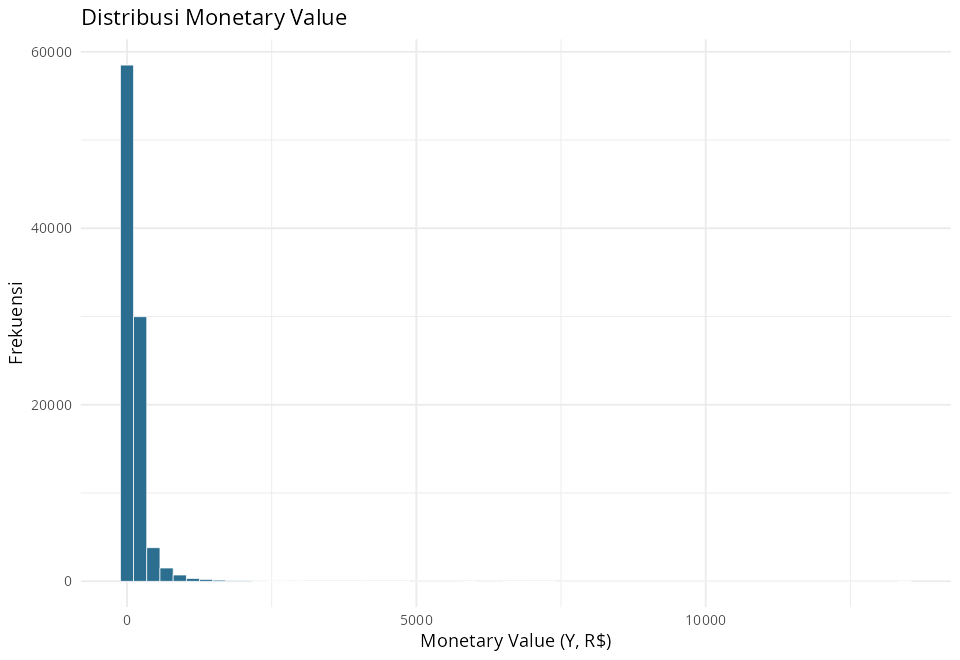
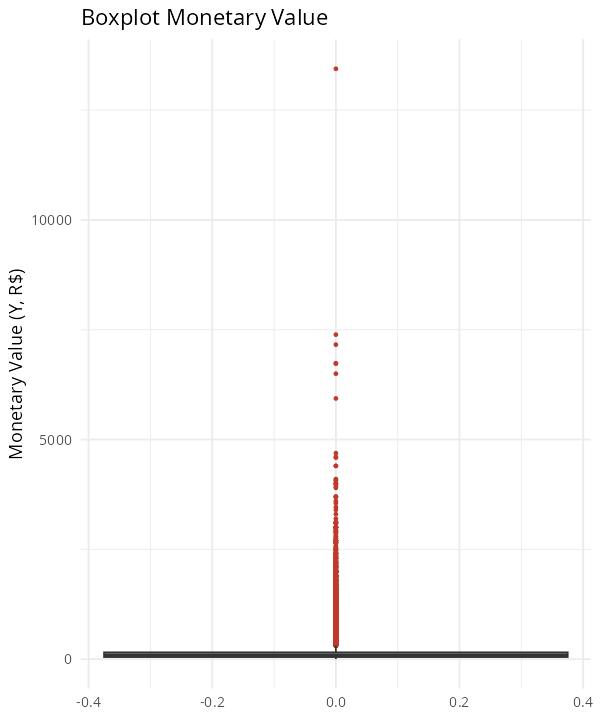
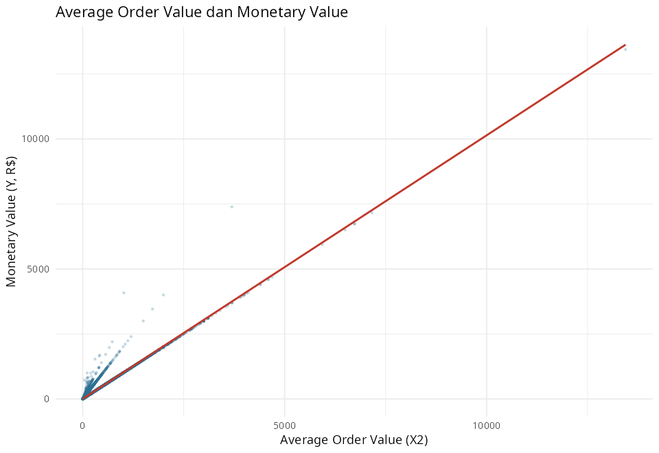
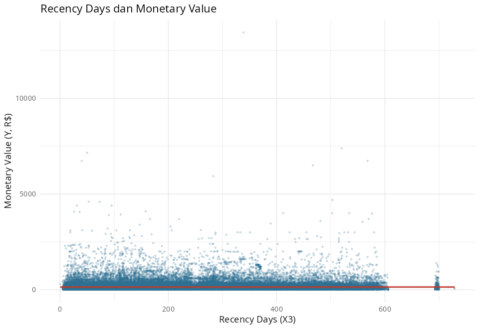
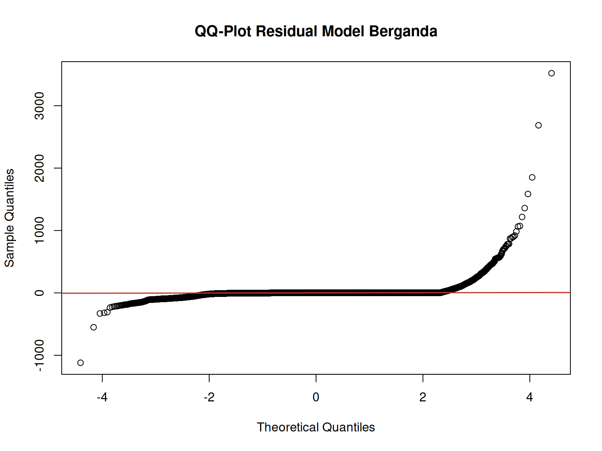

# Presentasi: Analisis regresi `Monetary_Value` pada e-commerce Brasil

Setiap slide memuat isi layar dan catatan demo. Path gambar dihitung relatif dari berkas `presentasi/slide.md`.

---

## Slide 1: Judul

**Isi slide**

- Analisis regresi `Monetary_Value` pada *Brazil E-commerce Orders Dataset*.
- Tugas Statistik, bidang Ekonomi dan Bisnis.
- Sumber data: Kaggle `mehmetisik/order-customerrfm`.
- Fokus: hubungan `Monetary_Value` dengan `Total_Purchases`, `Average_Order_Value`, dan `Recency_Days`.

**Catatan demo**

- Awali dengan unit analisis, yaitu pelanggan hasil agregasi transaksi, bukan transaksi produksi.
- Sebut bahwa seluruh angka pada slide berasal dari berkas hasil `R/analysis.R`.

---

## Slide 2: Tujuan proyek dan topik

**Isi slide**

- Bidang: Ekonomi dan Bisnis, dengan fokus pada total nilai transaksi pelanggan.
- Pertanyaan utama: variabel apa yang berkaitan dengan `Monetary_Value`?
- Tujuan: mengukur hubungan `Monetary_Value` dengan jumlah order, rata-rata nilai order, dan selisih hari sejak transaksi terakhir.
- Hasil akhir: perbandingan model regresi sederhana dan berganda, lalu tiga skenario prediksi di `output/tables/prediksi.csv`.

**Catatan demo**

- Tekankan bahwa analisis bersifat asosiatif, bukan sebab akibat.
- Sebut keempat variabel model sebelum masuk ke angka.

---

## Slide 3: Sumber data

**Isi slide**

- Dataset: *Brazil E-commerce Orders Dataset*, Kaggle `mehmetisik/order-customerrfm`.
- URL dataset: https://www.kaggle.com/datasets/mehmetisik/order-customerrfm
- Ukuran awal: 112.650 baris transaksi order-item dan 4 kolom.
- Cakupan: 98.666 order unik, 95.420 pelanggan, transaksi 2016-09-04 sampai 2018-09-03.
- Lisensi pada halaman Kaggle: Unknown. Pembaruan terakhir: 2023-06-09.

**Catatan demo**

- Tunjukkan URL dataset, lalu sebut bahwa berkas mentah disertakan di `data/raw/`.
- Jika ditanya soal wilayah, jawab terus terang bahwa datanya berasal dari e-commerce Brasil.

---

## Slide 4: Agregasi dan preprocessing

**Isi slide**

- Data transaksi diagregasi menjadi satu baris per `customer_unique_id`.
- `Monetary_Value` = penjumlahan `price`; `Total_Purchases` = jumlah `order_id` unik.
- `Average_Order_Value` = `Monetary_Value / Total_Purchases`; `Recency_Days` = selisih terhadap 2018-09-03.
- Agregasi menghasilkan 95.420 baris. `NA` pada variabel model: 0. Duplikat dibuang: 0. Baris final: 95.420.
- Baris transaksi identik tetap dihitung karena dataset tidak memuat identitas produk.

**Catatan demo**

- Buka `output/analisis_log.txt` dan arahkan ke bagian jumlah transaksi, order, pelanggan, serta jumlah baris akhir.
- Jelaskan bahwa `Total_Purchases` memakai order unik, bukan jumlah baris order-item.

---

## Slide 5: Variabel model

**Isi slide**

| Peran | Variabel | Keterangan |
|---|---|---|
| Y | `Monetary_Value` | Total nilai transaksi per pelanggan |
| X1 | `Total_Purchases` | Jumlah `order_id` unik per pelanggan |
| X2 | `Average_Order_Value` | Y dibagi X1 |
| X3 | `Recency_Days` | Hari sejak transaksi terakhir |

- Semua nilai uang dalam real Brasil (BRL, R$), bukan rupiah.
- X2 memiliki ketergantungan aljabar dengan Y, sehingga koefisien dan R² perlu dibaca dengan batasan itu.

**Catatan demo**

- Sebut pemetaan sekali di awal supaya pembaca tidak perlu menekan legenda grafik.
- Tunjukkan bahwa model tidak memakai kolom lain dari dataset.

---

## Slide 6: Statistik deskriptif

**Isi slide**

- Statistik deskriptif dihitung untuk Y, X1, X2, dan X3 pada sampel final n = 95.420.
- `Monetary_Value`: rataan R$ 142,44; median R$ 89,90; simpangan baku R$ 217,66; maksimum R$ 13.440.
- `Total_Purchases`: rataan 1,03; median 1; maksimum 16.
- `Recency_Days`: rataan 243,50; median 224; rentang 0 sampai 729.
- Tabel lengkap tersaji di `output/tables/statistik_deskriptif.csv`.

**Catatan demo**

- Tunjukkan histogram terlebih dahulu, lalu boxplot.
- Rujuk `statistik_deskriptif.csv` bila dosen meminta nilai mean, median, atau kuartil.

---

## Slide 7: Korelasi Pearson

**Isi slide**

| Pasangan | Koefisien korelasi |
|---|---:|
| Y dengan X1 | 0,106 |
| Y dengan X2 | 0,985 |
| Y dengan X3 | 0,001 |
| X1 dengan X2 | -0,011 |

- X2 memiliki korelasi tertinggi dengan Y, tetapi hubungannya berasal dari definisi X2 = Y / X1.
- X1 dan X3 hanya memiliki hubungan linear yang lemah dengan Y.
- Korelasi antar prediktor berada di sekitar nol.

**Catatan demo**

- Tunjukkan tiga scatter plot secara berurutan sesuai urutan tabel korelasi.
- Tekankan bahwa korelasi tinggi Y-X2 tidak diperluas menjadi klaim prediktif atau sebab akibat.

---

## Slide 8: Regresi linear sederhana

**Isi slide**

- Model: Y = 29,523 + 109,202 X1.
- Slope X1 = 109,202; intercept = 29,523.
- R² = 0,0112, sehingga model menjelaskan sekitar 1,12% variasi `Monetary_Value`.
- Setiap tambahan satu order unik berhubungan dengan tambahan R$ 109,202.

**Catatan demo**

- Tunjukkan `output/tables/regresi_sederhana.txt`.
- Kembali ke `scatter_purchases_y.png` saat menjelaskan slope dan sebaran titik.

---

## Slide 9: Regresi linear berganda

**Isi slide**

- Model: Y = -122,076 + 120,285 X1 + 1,015 X2 - 0,001 X3.
- R² = 0,9831; R² adjusted = 0,9831.
- Model berganda signifikan secara keseluruhan dengan F = 1.853.402.
- X1 dan X2 signifikan, sedangkan X3 tidak signifikan dengan p-value 0,264.
- R² naik dari 0,0112 menjadi 0,9831 setelah X2 dan X3 masuk, terutama karena X2 diturunkan dari Y.
- Intercept dan koefisien memakai R$ (X2: R$ per R$, X3: R$ per hari).

**Catatan demo**

- Tunjukkan `output/tables/regresi_berganda.txt`, khususnya kolom `Estimate` dan `Pr(>|t|)`.
- Kaitkan kenaikan R² dengan definisi X2 pada slide 5, bukan dengan klaim peningkatan kemampuan prediksi umum.

---

## Slide 10: Evaluasi asumsi dan prediksi

**Isi slide**

- Evaluasi asumsi memakai VIF, Shapiro-Wilk, dan Breusch-Pagan.
- VIF X1, X2, X3 berturut-turut 1,000619; 1,000133; 1,000515.
- Shapiro-Wilk: W = 0,21583 dan p < 2,2e-16. Breusch-Pagan: BP = 1992,3 dan p < 2,2e-16.
- Prediksi dihitung dari model berganda dengan interval kepercayaan 95%.

| Skenario | X1 | X2 (R$) | X3 | Prediksi Y (R$) |
|---|---:|---:|---:|---:|
| Rendah | 1 | 46,40 | 119 | 45,23 |
| Menengah | 1 | 87,38 | 224 | 86,75 |
| Tinggi | 1 | 149,90 | 353 | 150,12 |

- Batas bawah dan batas atas 95% untuk ketiga skenario tersaji di `output/tables/prediksi.csv`.

**Catatan demo**

- Tunjukkan `output/tables/uji_asumsi.txt` sebelum `output/tables/prediksi.csv`.
- Jelaskan bahwa angka prediksi merupakan ilustrasi model, bukan jaminan nilai pelanggan tertentu.

---

## Slide 11: Demo RStudio

**Isi slide**

- Pastikan working directory berada di root proyek `analisis-rfm-ecommerce-brasil` agar path relatif terbaca.
- Buka `R/analysis.R` di RStudio, lalu jalankan seluruh skrip dengan `Source` atau `Ctrl+Shift+Enter`.
- Tunjukkan `output/analisis_log.txt` untuk alur lengkap: 112.650 transaksi, 98.666 order, 95.420 pelanggan, R², uji asumsi, dan prediksi.
- Tunjukkan `output/tables/statistik_deskriptif.csv`, `korelasi.csv`, `regresi_sederhana.txt`, `regresi_berganda.txt`, `uji_asumsi.txt`, dan `prediksi.csv`.
- Tunjukkan `output/plots/hist_y.png`, `box_y.png`, `scatter_purchases_y.png`, `scatter_order_value_y.png`, `scatter_recency_y.png`, `residual_vs_fitted.png`, dan `qq_plot.png`.

**Catatan demo**

- Jalankan skrip sekali di depan kelas, lalu memakai hasil tersimpan untuk mempercepat sesi tanya jawab.
- Jika R melaporkan paket belum tersedia, pasang paket yang diminta oleh pesan galat sebelum menjalankan ulang skrip.

---

## Slide 12: Tanya jawab

**Isi slide**

- **Mengapa korelasi Y-X2 paling tinggi?** Nilainya 0,985 karena X2 dibentuk dari Y dibagi X1. Ini bukan penemuan prediktif baru.
- **Apakah X1 penting?** Ya. Korelasi Y-X1 sebesar 0,106 dan koefisien X1 sebesar 120,285 pada model berganda. X1 signifikan, tetapi variasi datanya kecil.
- **Apakah X3 penting?** Tidak pada model ini. Korelasi Y-X3 sebesar 0,001 dan p-value koefisien X3 sebesar 0,264.
- **Apakah model berganda layak?** Model signifikan secara keseluruhan dengan R² = 0,9831, tetapi angka itu mengandung identitas aljabar dan asumsi residual dilanggar.
- **Apakah datanya berasal dari Indonesia?** Tidak. Dataset mencatat transaksi e-commerce Brasil.
- **Mata uangnya apa?** Real Brasil (BRL, R$), bukan rupiah. Rataan Y = R$ 142,44.
- **Bolehkah angka prediksi dipakai?** Sebagai ilustrasi model, ya. Batas interval 95% dan tiga skenario tersaji di `prediksi.csv`, dengan interpretasi yang dibatasi oleh definisi X2 dan hasil uji asumsi.

**Catatan demo**

- Jawab dengan menyebut angka terlebih dahulu, lalu artinya.
- Hindari klaim sebab akibat. Seluruh koefisien dibaca sebagai hubungan dalam data.

---

## Lampiran aset plot

- `../output/plots/hist_y.png`
- `../output/plots/box_y.png`
- `../output/plots/scatter_purchases_y.png`
- `../output/plots/scatter_order_value_y.png`
- `../output/plots/scatter_recency_y.png`
- `../output/plots/residual_vs_fitted.png`
- `../output/plots/qq_plot.png`
